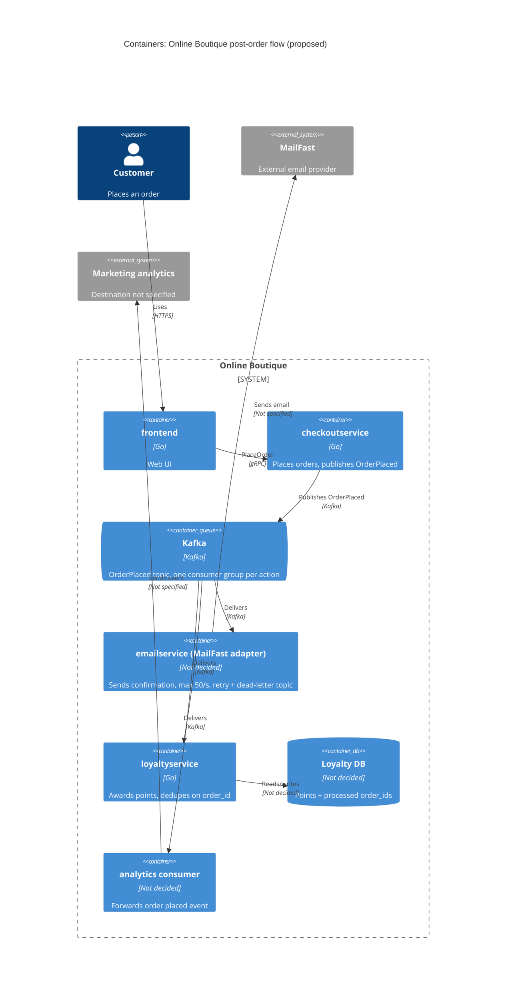

# ADR-0002: Publish an "OrderPlaced" event to Kafka for post-order actions

- **Status:** Proposed
- **Date:** 2026-10-26
- **Deciders:** Weerachai Panthueng (6970279321)

## Context and problem

Requirement R-12 (`docs/scenario.md`) กำหนดว่าหลังสั่งซื้อสำเร็จ ระบบต้อง (1) ส่งอีเมลยืนยันผ่าน **MailFast** แทน logic mock ของ `emailservice` (2) ให้ loyalty points ผ่าน `loyaltyservice` ตัวใหม่ (3) บันทึก analytics event "order placed" และ marketing คาดว่าจะมี post-order action เพิ่มอีกในปีหน้า (SMS, fraud scoring, recommendations update)

**สภาพปัจจุบัน (จากโค้ด):**

| ข้อเท็จจริง                                                                               | หลักฐาน                                                                                                       |
| ----------------------------------------------------------------------------------------- | ------------------------------------------------------------------------------------------------------------- |
| `PlaceOrder` เรียก `paymentservice` แล้ว `shippingservice` แบบ synchronous gRPC ตามลำดับ  | `system/online-boutique/src/checkoutservice/main.go` (`PlaceOrder`, บรรทัด 252 `chargeCard`, 258 `shipOrder`) |
| อีเมลยืนยันถูกส่งแบบ synchronous gRPC ไป `emailservice` หลังจากตัดเงินและส่งของแล้ว       | `main.go` บรรทัด 273 และ `sendOrderConfirmation` (บรรทัด 379–384)                                             |
| ถ้าส่งอีเมลล้มเหลว checkout แค่ log warning และ order ยังสำเร็จ                           | `main.go` บรรทัด 273–277 (`log.Warnf("failed to send order confirmation ...")`)                               |
| `checkoutservice` ผูกกับ downstream ทุกตัวผ่าน env var + gRPC connection ที่ตั้งตอน start | `main.go` `mustMapEnv(... "EMAIL_SERVICE_ADDR")` บรรทัด 115, `mustConnGRPC` บรรทัด 118–123                    |
| `orderID` สร้างด้วย `uuid.NewUUID()` ต้น `PlaceOrder`                                     | `main.go` บรรทัด 233                                                                                          |
| `checkoutservice` ไม่มี database ของตัวเอง                                                | ไม่พบการเชื่อมต่อ data store ใน `main.go` (มีแต่ gRPC clients)                                                |

**ตัวเลขที่บังคับการตัดสินใจ** (`docs/scenario.md`):

| หัวข้อ                            | ค่า                                                                                            | ผลกระทบ                                                                                                                                                                              |
| --------------------------------- | ---------------------------------------------------------------------------------------------- | ------------------------------------------------------------------------------------------------------------------------------------------------------------------------------------ |
| Checkout latency                  | p95 `PlaceOrder` ≤ **500 ms** (ปัจจุบัน ~300 ms)                                               | เหลืองบ latency แค่ ~200 ms                                                                                                                                                          |
| MailFast latency                  | p95 **1.5 s**, p99 **8 s**                                                                     | เรียก MailFast แบบ synchronous ใน `PlaceOrder` จะทำให้ p95 เกิน 500 ms ทันที                                                                                                         |
| Peak load vs. MailFast rate limit | **200 orders/s** vs. **50 emails/s** เป็นเวลา **10 นาที**                                      | scenario ไม่ได้ระบุความยาว peak; ADR นี้สมมติ 10 นาที ส่วนต่าง 150 ฉบับ/วินาที × 600 วินาที = backlog **90,000** ฉบับ ถ้าหลัง peak ไม่มีออเดอร์ใหม่ อีเมลใบสุดท้ายออกอีก **30 นาที** |
| MailFast failure rate             | ~**0.5 %**                                                                                     | ต้องมี retry                                                                                                                                                                         |
| Loyalty points                    | ภายใน **1 นาที**, **exactly once**                                                             | ต้องไม่ติด backlog ของอีเมล และต้อง dedupe                                                                                                                                           |
| Availability                      | order **ต้องไม่ล้มเหลว** เพราะ email/loyalty/analytics ล่ม                                     | post-order actions ต้องแยกออกจาก critical path                                                                                                                                       |
| Team / Ops                        | 4 devs, เก่ง Go + gRPC, 2 คนเคยใช้ **RabbitMQ**; รันบน Kubernetes; ชอบ open-source self-hosted | ประสบการณ์ Kafka ไม่ปรากฏใน scenario                                                                                                                                                 |

**ปัญหา:** จะเชื่อม `checkoutservice` กับ post-order actions อย่างไร ให้ checkout เร็วและไม่ล้มตาม ขณะที่ action ปลายทางทำงานครบ (อีเมลภายใต้ rate limit, loyalty ภายใน 1 นาทีแบบ exactly once) และเพิ่ม action ใหม่ได้โดยไม่แก้ `checkoutservice` ทุกครั้ง

## Decision drivers

1. **Availability:** order ต้องไม่ล้มเพราะ MailFast, `loyaltyservice` หรือ analytics ล่ม
2. **Performance:** p95 `PlaceOrder` ≤ 500 ms ที่ 200 orders/s
3. **Reliability / correctness:** loyalty points ภายใน 1 นาที, exactly once; อีเมลต้องถูก retry เมื่อ MailFast fail (0.5 %) และต้องไม่เกิน 50 emails/s
4. **Modifiability:** เพิ่ม post-order action ใหม่ (SMS, fraud scoring, recommendations) โดยไม่ต้องแก้และ deploy `checkoutservice`
5. **Cost / operability:** open-source, self-hosted บน Kubernetes; ทีมเล็ก 4 คนต้องดูแลได้ (ใช้ทักษะ Go/gRPC/RabbitMQ ที่มีอยู่)

## Considered options

1. **Synchronous gRPC fan-out ใน `PlaceOrder`** — ขยายรูปแบบเดิม: เรียก MailFast adapter, `loyaltyservice`, analytics ทีละตัวแบบ synchronous
2. **Asynchronous in-process (goroutine) ใน `checkoutservice`** — ตอบ client ก่อน แล้วยิง post-order calls ใน background goroutine
3. **Publish event `OrderPlaced` ไป RabbitMQ (self-hosted)** — `checkoutservice` publish หนึ่ง event ไปยัง fanout/topic exchange; แต่ละ action มี queue และ consumer ของตัวเอง
4. **Publish event ไป Apache Kafka (self-hosted)** — แนวคิดเดียวกับข้อ 3 แต่ใช้ log-based broker และแยกงานด้วย consumer group

### Pros and cons of the options

| Option                            | Pros                                                                                                                                                                                                                                                                    | Cons                                                                                                                                                                                                                                                          |
| --------------------------------- | ----------------------------------------------------------------------------------------------------------------------------------------------------------------------------------------------------------------------------------------------------------------------- | ------------------------------------------------------------------------------------------------------------------------------------------------------------------------------------------------------------------------------------------------------------- |
| 1. Sync gRPC fan-out              | ง่าย, ทีมถนัด gRPC; เหมือนโค้ดเดิม; ไม่มี component ใหม่                                                                                                                                                                                                                | MailFast p95 1.5 s ทำให้ p95 checkout เกิน 500 ms; rate limit 50/s รับ 200 orders/s ไม่ได้; ถ้าทำ fail-soft แบบอีเมลเดิม (บรรทัด 273–277) งานที่ fail จะ**หายไป** (ไม่มี retry → loyalty ผิด requirement); `checkoutservice` ต้องแก้ทุกครั้งที่มี action ใหม่ |
| 2. Goroutine ใน `checkoutservice` | latency checkout ไม่เพิ่ม; ไม่มี infrastructure ใหม่                                                                                                                                                                                                                    | งานอยู่ในหน่วยความจำ — pod restart/scale-down = งานหาย; คุม rate 50/s ข้าม replicas ไม่ได้; retry/backlog 90,000 อีเมลของ peak 10 นาทีต้องทำเองในหน่วยความจำ; ยังคง coupling กับทุก action                                                                    |
| 3. RabbitMQ events                | decouple: checkout แค่ publish (async, durable); queue แยกต่อ action → อีเมลค้างไม่กระทบ loyalty; consumer อีเมล throttle ที่ 50/s และ retry/DLQ ได้; เพิ่ม action ใหม่ = เพิ่ม queue + consumer โดยไม่แตะ checkout; open-source, รันบน Kubernetes; 2 devs มีประสบการณ์ | component stateful ใหม่ต้องดูแล (cluster, quorum queues, monitoring); delivery เป็น at-least-once → consumer ต้อง idempotent; ถ้า publish ล้มหลังตัดเงินแล้ว event อาจหาย (ไม่มี outbox เพราะ checkout ไม่มี DB); eventual consistency                        |
| 4. Kafka events                   | consumer group แยกต่อ action จึงให้ loyalty ไม่ติด backlog อีเมล; replay log ได้ ซึ่งตรงกับ analytics และ recommendations ในอนาคต; open-source self-hosted; 200 events/s อยู่ในพิสัยที่ Kafka รับได้                                                                    | ทีมไม่มีประสบการณ์ Kafka ใน scenario; ดูแลยากกว่าสำหรับทีม 4 คน; 200 events/s ไม่ได้ต้องการ throughput สูงสุดของ Kafka; rate limiting, retry และ dead-letter ต้องทำที่ consumer                                                                               |

## Decision

เลือก **Option 4: publish event `OrderPlaced` ไปยัง Kafka (self-hosted บน Kubernetes)**

- `checkoutservice.PlaceOrder` publish **หนึ่ง** record `OrderPlaced` (มี `order_id`, email, items, total) ไป topic เดียว หลัง `shipOrder` สำเร็จ แทนการเรียก `emailservice` ที่บรรทัด 273 โดยใช้ producer `acks=all` และ timeout สั้น; ถ้า publish ล้มเหลว ให้ log + metric แต่ order **ยังสำเร็จ** (คง behaviour fail-soft เดิม)
- แต่ละ action เป็น **consumer group** ของ topic เดียวกัน:
  - `email` → consumer (ปรับ `emailservice` เดิมให้เป็น MailFast adapter) จำกัดอัตรารวมไม่เกิน 50 emails/s, retry แบบ backoff, ส่งเข้า dead-letter topic เมื่อ retry หมด
  - `loyalty` → `loyaltyservice` เขียนด้วย **Go** บันทึก `order_id` ที่ประมวลผลแล้ว (idempotency key) เพื่อให้ at-least-once delivery กลายเป็น **effectively exactly-once**
  - `analytics` → consumer ที่ส่ง event ให้ระบบ analytics ของ marketing
- Action ในอนาคต (SMS, fraud scoring, recommendations) = เพิ่ม consumer group ใหม่ ไม่ต้องแก้ `checkoutservice`. Recommendations ใช้ replay ของ log นี้ได้

**เหตุผล:** Option 4 ตอบ driver 1–4 ได้เท่ากับ RabbitMQ — ตัด MailFast (p95 1.5 s) ออกจาก critical path, ดูดซับส่วนต่าง 200 vs 50/s ใน log, แยก loyalty ออกจาก backlog อีเมลด้วย consumer group คนละตัว และเพิ่ม action ใหม่โดยไม่แก้ checkout ผู้ตัดสินใจเลือก Kafka แทน RabbitMQ เพราะต้องการ log ที่ replay ได้สำหรับ analytics และ recommendations ปีหน้า และยอมรับต้นทุนของ driver 5: scenario มีประสบการณ์ RabbitMQ 2 คน แต่ไม่มีประสบการณ์ Kafka และ retry / dead-letter / rate limit ต้องอยู่ที่ consumer

## Consequences

- **Positive:** `PlaceOrder` ไม่ต้องรอ MailFast/loyalty/analytics อีกต่อไป — เพิ่มแค่เวลา publish หนึ่งครั้ง จึงคาดว่า p95 ยังอยู่ใต้ 500 ms (quality attribute: performance) — เวลา publish จริงยังไม่ได้วัด ดู Validation
- **Positive:** order สำเร็จได้แม้ consumer ทุกตัวล่ม; record ค้างใน log จน consumer กลับมา (quality attribute: availability)
- **Positive:** email consumer group ดูดซับ peak 10 นาที (backlog 90,000 ฉบับ) แล้วระบายที่ 50/s โดย loyalty consumer group ไม่ต้องรอคิวนี้; retry + dead-letter topic รับมือ 0.5 % failure ของ MailFast (quality attribute: reliability, scalability)
- **Positive:** เพิ่ม post-order action ใหม่ได้โดยไม่แก้ `checkoutservice` และ replay log ได้สำหรับ analytics / recommendations (quality attribute: modifiability)
- **Negative:** อีเมลยืนยันไม่ได้ส่งทันที — อีเมลใบสุดท้ายของ peak 10 นาทีออกช้าประมาณ 30 นาที ถ้าหลัง peak ไม่มีออเดอร์ใหม่ (quality attribute: usability / timeliness)
- **Negative:** Kafka เป็น stateful component ใหม่ที่ทีม 4 คนต้องดูแล ทั้งที่ประสบการณ์ใน scenario เป็น RabbitMQ ไม่ใช่ Kafka (quality attribute: cost, operability)
- **Negative:** debug ยากขึ้น — flow ไม่ใช่ call chain เดียว ต้อง propagate trace context ผ่าน record headers (ปัจจุบันมี OpenTelemetry สำหรับ gRPC ที่ `main.go` บรรทัด 134–140) (quality attribute: observability)
- **Risks and mitigations:**
  - _Event หายถ้า publish ล้มหลังตัดเงินแล้ว_ (ไม่มี outbox เพราะ `checkoutservice` ไม่มี DB) → loyalty ไม่ถูกให้ ซึ่งผิด requirement. Mitigation: `acks=all` + retry สั้นๆ ภายในงบ latency, alert บน metric publish-failure; พิจารณา transactional outbox หากมี order store ในอนาคต (ดู Open questions)
  - _Duplicate delivery → double points._ Mitigation: `loyaltyservice` dedupe ด้วย `order_id` (unique constraint) ใน transaction เดียวกับการเพิ่มแต้ม
  - _Loyalty เกิน 1 นาที._ Mitigation: consumer group แยกจากอีเมล, alert เมื่อ lag ของ group `loyalty` เสี่ยงเกิน 60 s
  - _Kafka เป็น single point of failure ของ post-order actions._ Mitigation: รันมากกว่าหนึ่ง broker บน Kubernetes เพื่อให้ log อยู่รอดเมื่อ broker ตัวหนึ่งล่ม; จำนวน broker ยังไม่กำหนด (ดู Open questions)
  - _ใช้ quota MailFast เกิน 50/s เมื่อ scale consumer ใน group `email`._ Mitigation: ผลรวมอัตราของทุก instance ใน group ≤ 50/s และ test

## Validation

- **Load test** ด้วย 200 orders/s เป็นเวลา **10 นาที** (เช่น Locust `loadgenerator`) แล้วตรวจ:
  - p95 `PlaceOrder` ≤ 500 ms
  - p99 เวลาจาก order → loyalty points ถูกบันทึก ≤ 60 s
  - อัตราการเรียก MailFast ไม่เกิน 50/s และไม่มี error 429/rate-limit
  - backlog อีเมลตอนจบ peak ประมาณ 90,000 ฉบับ และระบายหมดในประมาณ 30 นาทีเมื่อไม่มีออเดอร์ใหม่
  - จำนวน loyalty award = จำนวน order พอดี (ไม่มีซ้ำ, ไม่หาย) แม้ inject duplicate record
- **Chaos test:** หยุด consumer group แต่ละตัว และ mock MailFast ให้ fail → order ต้องยังสำเร็จ 100 % และ record ถูกประมวลผลครบเมื่อกลับมา
- **Metrics ใน production:** consumer lag ต่อ group, ขนาด dead-letter topic, publish-failure count
- **Review date:** ทบทวน ADR หลัง 11.11 ครั้งแรก หรือก่อนเพิ่ม action ใหม่ (SMS/fraud scoring) — วันที่แน่นอนยังไม่ระบุ

## Open questions

- **SLA ของอีเมลยืนยัน:** ธุรกิจยอมให้อีเมลใบสุดท้ายช้าประมาณ 30 นาทีหลัง peak 10 นาทีหรือไม่
- **Latency ของ publish ไป Kafka (พร้อม `acks=all`):** Not evidenced in the provided files — ต้องวัดจริง
- **Event หายยอมรับได้หรือไม่:** ถ้ายอมรับไม่ได้เลย ต้องเพิ่ม order store + transactional outbox ใน `checkoutservice` (ขยาย scope)
- **ปลายทาง analytics:** marketing ใช้ระบบอะไร, รูปแบบ event, ยอมให้หายได้หรือไม่ — Not evidenced in the provided files
- **MailFast API:** protocol (HTTPS/SMTP), รองรับ idempotency key หรือไม่ (กันส่งอีเมลซ้ำเมื่อ retry), rate limit 50/s เป็นต่อ account หรือต่อ connection
- **Data store ของ `loyaltyservice`:** ยังไม่กำหนด; ภาษาที่ใช้คือ Go
- **ขนาด Kafka cluster และความพร้อมของทีม** (on-call, backup, upgrade) — scenario ระบุแค่ 2 คนที่เคยใช้ RabbitMQ
- **Fraud scoring ในอนาคต:** อาจต้อง _บล็อก_ order (synchronous) ไม่ใช่ post-order action — ถ้าเป็นเช่นนั้นต้องมี ADR แยก
