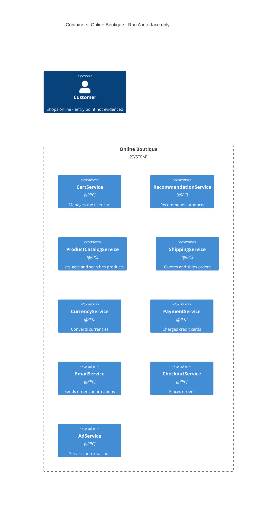

# Task 1, Run A: สถาปัตยกรรมที่กู้คืนได้ (เฉพาะ interface)

## 1. Agent

Claude Code (Anthropic) รุ่น Claude Opus 5.5 (`claude-opus-5-5`)

## 2. Files read

- `prompts/1-recover-architecture.md` (คำสั่งของงาน)
- `system/online-boutique/protos/demo.proto` (หลักฐานเพียงไฟล์เดียวที่ได้รับอนุญาต)

## 3. Containers table

container ทั้งหมดมาจากบล็อก `service` ใน `demo.proto` แต่ไฟล์ proto นิยามเพียง interface ไม่ได้บอกหน่วยที่ deploy จริง ตารางนี้จึงสมมติว่า **หนึ่ง gRPC service = หนึ่ง container** **[Inferred]** และเนื่องจาก proto ไม่ได้ระบุชื่อที่ใช้ตอน deploy จึงใช้ชื่อ service ตามที่ประกาศใน proto

| Container | Technology / language | Responsibility (จาก RPC) | Evidence |
|---|---|---|---|
| CartService | gRPC (proto3); ภาษา Not evidenced in the provided files | เพิ่มสินค้า ดึง และล้างตะกร้าของผู้ใช้ (`AddItem`, `GetCart`, `EmptyCart`) | `system/online-boutique/protos/demo.proto` (`service CartService`, บรรทัด 23–27) |
| RecommendationService | gRPC (proto3); ภาษา Not evidenced in the provided files | แนะนำรายการ product ID ตามผู้ใช้และชุดสินค้าที่ส่งมา (`ListRecommendations`) | `demo.proto` (`service RecommendationService`, บรรทัด 56–58) |
| ProductCatalogService | gRPC (proto3); ภาษา Not evidenced in the provided files | แสดงรายการ ดึง และค้นหาสินค้า (`ListProducts`, `GetProduct`, `SearchProducts`) | `demo.proto` (`service ProductCatalogService`, บรรทัด 71–75) |
| ShippingService | gRPC (proto3); ภาษา Not evidenced in the provided files | ประเมินค่าจัดส่ง จัดส่งคำสั่งซื้อ และคืน tracking ID (`GetQuote`, `ShipOrder`) | `demo.proto` (`service ShippingService`, บรรทัด 107–110) |
| CurrencyService | gRPC (proto3); ภาษา Not evidenced in the provided files | แสดงสกุลเงินที่รองรับ และแปลง `Money` ระหว่างสกุลเงิน (`GetSupportedCurrencies`, `Convert`) | `demo.proto` (`service CurrencyService`, บรรทัด 140–143) |
| PaymentService | gRPC (proto3); ภาษา Not evidenced in the provided files | ตัดเงินจากบัตรเครดิต และคืน transaction ID (`Charge`) | `demo.proto` (`service PaymentService`, บรรทัด 177–179) |
| EmailService | gRPC (proto3); ภาษา Not evidenced in the provided files | ส่งอีเมลยืนยันคำสั่งซื้อ (`SendOrderConfirmation`) | `demo.proto` (`service EmailService`, บรรทัด 199–201) |
| CheckoutService | gRPC (proto3); ภาษา Not evidenced in the provided files | สร้างคำสั่งซื้อ และคืน `OrderResult` (`PlaceOrder`) | `demo.proto` (`service CheckoutService`, บรรทัด 224–226) |
| AdService | gRPC (proto3); ภาษา Not evidenced in the provided files | คืนโฆษณาตามคีย์เวิร์ดบริบทของหน้าเว็บ (`GetAds`) | `demo.proto` (`service AdService`, บรรทัด 243–245) |

Data store: **Not evidenced in the provided files** ไม่มี service หรือ message ใดใน proto ที่ระบุถึง database, cache หรือ queue

## 4. Dependencies table

| Caller → callee | Protocol | Evidence |
|---|---|---|
| *(ไม่มีรายการที่มีหลักฐาน)* | | |

ไฟล์ `.proto` นิยามเฉพาะ **ฝั่ง server** ของแต่ละ interface ไม่ได้บอกว่า service ใดเป็น **client** ของ service ใด หลักฐานนี้จึงพิสูจน์ runtime dependency ไม่ได้เลยแม้แต่รายการเดียว dependency ที่อนุมานจากรูปแบบของ message อยู่ในหัวข้อ **Gaps** ไม่ได้อยู่ในตารางนี้

## 5. Mermaid diagram

แผนภาพตรงกับตารางทั้งสอง คือมี container เก้าตัวและไม่มี `Rel` เลย เพราะไม่มี dependency ใดที่มีหลักฐาน รวมถึงความสัมพันธ์ของผู้ใช้ปลายทางด้วย เนื่องจากไม่มีหลักฐานว่าผู้ใช้เข้าระบบผ่านส่วนใด

## 6. Gaps

| สิ่งที่ยังไม่รู้ | สิ่งที่ proto บ่งชี้ (ไม่ใช่หลักฐานยืนยัน) | ไฟล์ที่จะยืนยันได้ |
|---|---|---|
| **ใครเรียกใคร** ไม่มีหลักฐานของความสัมพันธ์ caller → callee เลย | **[Inferred]** `CheckoutService` น่าจะเรียก Cart, ProductCatalog, Currency, Shipping, Payment และ Email เพราะ `PlaceOrderRequest` มี `user_id`, `user_currency`, `Address`, `email` และ `CreditCardInfo` (บรรทัด 228–235) และ `OrderResult` มี tracking ID ค่าจัดส่ง และรายการสินค้าพร้อมราคา (บรรทัด 208–214) ซึ่งเป็น input และ output ของ service เหล่านั้น | ซอร์สโค้ดของ checkout (เช่น `src/checkoutservice/`) หรือไฟล์ deploy (`kubernetes-manifests/`) ซึ่งจะมีตัวแปรที่อยู่ของแต่ละ service |
| **จุดเข้าใช้งานของผู้ใช้** ไม่มี web UI หรือ frontend service ใน proto | **[Inferred]** น่าจะมี front end บางตัว (web app หรือ API gateway) ที่เรียก `CheckoutService`, `CartService`, `AdService`, `RecommendationService` ฯลฯ แทนลูกค้า เพราะไม่มีส่วนอื่นใน proto ที่เรียก service เหล่านี้ | `kubernetes-manifests/` (Deployment ของ frontend และ Service ที่เปิดออกภายนอก) หรือ `src/` |
| **Data store** ไม่รู้ว่าเก็บตะกร้า สินค้า และโฆษณาไว้ที่ใด | **[Inferred]** `CartService` ต้องเก็บ state ของตะกร้าตาม `user_id` ไว้ที่ใดที่หนึ่ง (มี `AddItem`/`GetCart` แต่ proto ไม่ได้บอกว่าเก็บที่ใด) | ซอร์สโค้ดและ manifest ของ cart service (เช่น Deployment ของ Redis หรือ database) |
| **ภาษาและ runtime** ของแต่ละ service | `option go_package` (บรรทัด 19) บอกเพียงว่าสร้าง stub ภาษา Go ได้ ไม่ได้บอกว่า service ใดเขียนด้วย Go | โฟลเดอร์ซอร์สโค้ดหรือ Dockerfile ของแต่ละ service ใน `src/` |
| **ขอบเขตการ deploy** แต่ละ service ใน proto แยกเป็น container ของตัวเอง หรือหลายตัวรวมอยู่ใน process เดียว | สมมติว่าหนึ่ง service = หนึ่ง container **[Inferred]** | `kubernetes-manifests/` |
| **ระบบภายนอก** (ผู้ให้บริการชำระเงินจริง, email server, บริษัทขนส่ง) | Not evidenced in the provided files: `PaymentService` และ `EmailService` อาจเป็น mock หรืออาจเรียกบริการภายนอกก็ได้ | ซอร์สโค้ดของ payment และ email service |
| **รูปแบบการสื่อสารอื่นนอกจาก gRPC** (HTTP ระหว่าง browser กับ UI, message broker) | Not evidenced in the provided files: ทุก RPC เป็นแบบ unary request/response ไม่มี streaming (ไม่มีคีย์เวิร์ด `stream` ในไฟล์) | manifest และซอร์สโค้ด |
