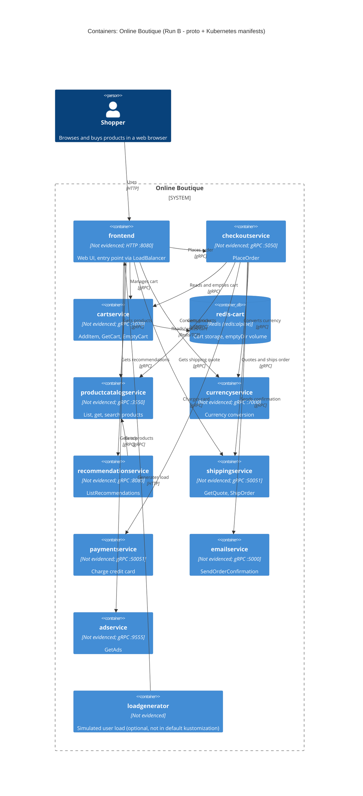

# Task 1 · Run B: Recovered C4 container architecture (Online Boutique)

## 1. Agent

- Claude Code (Anthropic) · model: Claude Opus 5.5 (`claude-opus-5-5`)

## 2. Files read

| # | ไฟล์ |
|---|---|
| 1 | `prompts/1-recover-architecture.md` (ไฟล์ task) |
| 2 | `system/online-boutique/protos/demo.proto` |
| 3 | `system/online-boutique/kubernetes-manifests/kustomization.yaml` |
| 4 | `system/online-boutique/kubernetes-manifests/README.md` |
| 5 | `system/online-boutique/kubernetes-manifests/frontend.yaml` |
| 6 | `system/online-boutique/kubernetes-manifests/checkoutservice.yaml` |
| 7 | `system/online-boutique/kubernetes-manifests/cartservice.yaml` |
| 8 | `system/online-boutique/kubernetes-manifests/recommendationservice.yaml` |
| 9 | `system/online-boutique/kubernetes-manifests/productcatalogservice.yaml` |
| 10 | `system/online-boutique/kubernetes-manifests/currencyservice.yaml` |
| 11 | `system/online-boutique/kubernetes-manifests/shippingservice.yaml` |
| 12 | `system/online-boutique/kubernetes-manifests/paymentservice.yaml` |
| 13 | `system/online-boutique/kubernetes-manifests/emailservice.yaml` |
| 14 | `system/online-boutique/kubernetes-manifests/adservice.yaml` |
| 15 | `system/online-boutique/kubernetes-manifests/loadgenerator.yaml` |

หมายเหตุ: ไม่ได้ใช้คำสั่ง terminal ในการ list โฟลเดอร์ จึงหาไฟล์จากรายการ `resources` ใน `kustomization.yaml` (รวมถึง `loadgenerator.yaml` ที่ถูก comment ไว้) และ `README.md` หากในโฟลเดอร์มีไฟล์อื่นนอกเหนือจากนี้ ไฟล์เหล่านั้นไม่ได้ถูกอ่าน

## 3. Containers table

ภาษา/เทคโนโลยีของแต่ละ service **ไม่ปรากฏในหลักฐาน** เพราะใน manifest มีเพียงชื่อ image ทั่วไป (เช่น `image: frontend`) ไม่มี tag หรือ base image ที่บ่งบอกภาษา

| Container | Technology / language | Responsibility | Evidence |
|---|---|---|---|
| `frontend` | Not evidenced in the provided files (HTTP server, port 8080) | Web UI/จุดเข้าระบบของผู้ใช้ เปิดออกภายนอกผ่าน Service ชนิด `LoadBalancer` และเรียก backend services | `kubernetes-manifests/frontend.yaml` (Deployment `frontend`, Service `frontend-external` `type: LoadBalancer`, `httpGet path: "/_healthz"`) |
| `checkoutservice` | Not evidenced (gRPC server, port 5050) | สั่งซื้อ (`PlaceOrder`) | `protos/demo.proto` (`service CheckoutService`); `kubernetes-manifests/checkoutservice.yaml` |
| `cartservice` | Not evidenced (gRPC server, port 7070) | จัดการตะกร้าสินค้า (`AddItem`, `GetCart`, `EmptyCart`) | `protos/demo.proto` (`service CartService`); `kubernetes-manifests/cartservice.yaml` |
| `redis-cart` | Redis (`image: redis:alpine`) | ที่เก็บข้อมูลตะกร้า; volume เป็น `emptyDir` (ข้อมูลไม่คงทนเมื่อ pod ถูกลบ) | `kubernetes-manifests/cartservice.yaml` (Deployment `redis-cart`, `volumes: redis-data emptyDir`) |
| `productcatalogservice` | Not evidenced (gRPC server, port 3550) | แค็ตตาล็อกสินค้า (`ListProducts`, `GetProduct`, `SearchProducts`) | `protos/demo.proto` (`service ProductCatalogService`); `kubernetes-manifests/productcatalogservice.yaml` |
| `currencyservice` | Not evidenced (gRPC server, port 7000) | แปลงสกุลเงิน (`GetSupportedCurrencies`, `Convert`) | `protos/demo.proto` (`service CurrencyService`); `kubernetes-manifests/currencyservice.yaml` |
| `recommendationservice` | Not evidenced (gRPC server, port 8080) | แนะนำสินค้า (`ListRecommendations`) | `protos/demo.proto` (`service RecommendationService`); `kubernetes-manifests/recommendationservice.yaml` |
| `shippingservice` | Not evidenced (gRPC server, port 50051) | คำนวณค่าส่งและจัดส่ง (`GetQuote`, `ShipOrder`) | `protos/demo.proto` (`service ShippingService`); `kubernetes-manifests/shippingservice.yaml` |
| `paymentservice` | Not evidenced (gRPC server, port 50051) | ตัดเงินบัตรเครดิต (`Charge`) | `protos/demo.proto` (`service PaymentService`); `kubernetes-manifests/paymentservice.yaml` |
| `emailservice` | Not evidenced (gRPC server, container port 8080, Service port 5000) | ส่งอีเมลยืนยันคำสั่งซื้อ (`SendOrderConfirmation`) | `protos/demo.proto` (`service EmailService`); `kubernetes-manifests/emailservice.yaml` |
| `adservice` | Not evidenced (gRPC server, port 9555) | ให้โฆษณาตาม context (`GetAds`) | `protos/demo.proto` (`service AdService`); `kubernetes-manifests/adservice.yaml` |
| `loadgenerator` | Not evidenced (มี init container `busybox`) | สร้าง load จำลองผู้ใช้ (`USERS: "10"`, `RATE: "1"`) — **ไม่อยู่ใน deployment ปกติ** (ถูก comment ใน `kustomization.yaml`) | `kubernetes-manifests/loadgenerator.yaml`; `kubernetes-manifests/kustomization.yaml` (`# - loadgenerator.yaml`) |

หลักฐานว่าใช้ gRPC: ทุก backend service มี `readinessProbe`/`livenessProbe` แบบ `grpc:` และ Service port ชื่อ `grpc`; ส่วน `frontend` ใช้ `httpGet` และ port ชื่อ `http`

## 4. Dependencies table

ชื่อ RPC ที่ caller น่าจะเรียกมาจาก `demo.proto` แต่ proto ไม่ได้บอกว่าใครเรียก RPC ไหน จึงระบุเป็น **[Inferred]**; ตัว dependency เองมีหลักฐานจาก environment variable

| Caller → Callee | Protocol | Evidence |
|---|---|---|
| User (browser) → `frontend` | HTTP | `frontend.yaml` (Service `frontend-external`, `type: LoadBalancer`, port `name: http` 80→8080) |
| `loadgenerator` → `frontend` | HTTP | `loadgenerator.yaml` (`FRONTEND_ADDR: "frontend:80"`, `wget http://${FRONTEND_ADDR}`) |
| `frontend` → `productcatalogservice` | gRPC | `frontend.yaml` (`PRODUCT_CATALOG_SERVICE_ADDR: productcatalogservice:3550`); `productcatalogservice.yaml` (port `grpc`) |
| `frontend` → `currencyservice` | gRPC | `frontend.yaml` (`CURRENCY_SERVICE_ADDR: currencyservice:7000`); `currencyservice.yaml` (port `grpc`) |
| `frontend` → `cartservice` | gRPC | `frontend.yaml` (`CART_SERVICE_ADDR: cartservice:7070`); `cartservice.yaml` (port `grpc`) |
| `frontend` → `recommendationservice` | gRPC | `frontend.yaml` (`RECOMMENDATION_SERVICE_ADDR: recommendationservice:8080`); `recommendationservice.yaml` (port `grpc`) |
| `frontend` → `shippingservice` | gRPC | `frontend.yaml` (`SHIPPING_SERVICE_ADDR: shippingservice:50051`); `shippingservice.yaml` (port `grpc`) — [Inferred] ใช้ `GetQuote` |
| `frontend` → `checkoutservice` | gRPC | `frontend.yaml` (`CHECKOUT_SERVICE_ADDR: checkoutservice:5050`); `checkoutservice.yaml` (port `grpc`) — [Inferred] ใช้ `PlaceOrder` |
| `frontend` → `adservice` | gRPC | `frontend.yaml` (`AD_SERVICE_ADDR: adservice:9555`); `adservice.yaml` (port `grpc`) |
| `checkoutservice` → `productcatalogservice` | gRPC | `checkoutservice.yaml` (`PRODUCT_CATALOG_SERVICE_ADDR: productcatalogservice:3550`) |
| `checkoutservice` → `shippingservice` | gRPC | `checkoutservice.yaml` (`SHIPPING_SERVICE_ADDR: shippingservice:50051`) — [Inferred] ใช้ `GetQuote`/`ShipOrder` |
| `checkoutservice` → `paymentservice` | gRPC | `checkoutservice.yaml` (`PAYMENT_SERVICE_ADDR: paymentservice:50051`); `paymentservice.yaml` (port `grpc`) |
| `checkoutservice` → `emailservice` | gRPC | `checkoutservice.yaml` (`EMAIL_SERVICE_ADDR: emailservice:5000`); `emailservice.yaml` (Service port `grpc` 5000→8080) |
| `checkoutservice` → `currencyservice` | gRPC | `checkoutservice.yaml` (`CURRENCY_SERVICE_ADDR: currencyservice:7000`) |
| `checkoutservice` → `cartservice` | gRPC | `checkoutservice.yaml` (`CART_SERVICE_ADDR: cartservice:7070`) — [Inferred] ใช้ `GetCart`/`EmptyCart` |
| `recommendationservice` → `productcatalogservice` | gRPC | `recommendationservice.yaml` (`PRODUCT_CATALOG_SERVICE_ADDR: productcatalogservice:3550`) |
| `cartservice` → `redis-cart` | Redis protocol over TCP | `cartservice.yaml` (`REDIS_ADDR: redis-cart:6379`; Service `redis-cart` port `name: tcp-redis`) |

## 5. Mermaid diagram

## 6. Gaps

| สิ่งที่ยังระบุไม่ได้ | เหตุผล | ไฟล์ที่จะช่วยยืนยัน |
|---|---|---|
| ภาษา/framework ของแต่ละ service | manifest ใช้ชื่อ image เปล่า ๆ (เช่น `image: cartservice`); README บอกว่า tag จะถูกใส่โดย `skaffold` | `system/online-boutique/src/<service>/Dockerfile` หรือไฟล์ build (เช่น `go.mod`, `package.json`, `*.csproj`, `build.gradle`) |
| `shoppingassistantservice` | `frontend.yaml` มี `SHOPPING_ASSISTANT_SERVICE_ADDR: shoppingassistantservice:80` แต่ไม่มี manifest ในโฟลเดอร์นี้ และ component `shopping-assistant` ถูก comment ใน `kustomization.yaml` จึงไม่ใส่ในแผนภาพ | `system/online-boutique/kustomize/components/shopping-assistant/` และโค้ด frontend (ตรวจ `ENABLE_ASSISTANT`) |
| Packaging service (ภายนอก) | `PACKAGING_SERVICE_URL` ถูก comment ใน `frontend.yaml` (เป็น optional demo) | โค้ด `system/online-boutique/src/frontend/` |
| ระบบภายนอกของ `paymentservice` (payment gateway จริงหรือ mock) | proto มีแค่ `Charge`; manifest ไม่มี env var ชี้ไประบบภายนอก | `system/online-boutique/src/paymentservice/` |
| ระบบภายนอกของ `emailservice` (SMTP/email provider จริงหรือไม่) | ไม่มี env var ของ mail server ใน `emailservice.yaml` | `system/online-boutique/src/emailservice/` |
| RPC ที่แต่ละ caller เรียกจริง และ dependency ที่ไม่ได้ส่งผ่าน env var | proto บอกเพียง interface ไม่บอก caller; dependency ที่ hard-code ในโค้ดจะไม่ปรากฏใน manifest | โค้ด client ใน `system/online-boutique/src/frontend/` และ `system/online-boutique/src/checkoutservice/` |
| data store ของ `productcatalogservice`, `currencyservice`, `adservice` | manifest ไม่มี volume หรือ env var ของ database [Inferred: อาจโหลดข้อมูลจากไฟล์ใน image] | โค้ดใน `system/online-boutique/src/productcatalogservice/` ฯลฯ |
| data store ทางเลือกของ cart (Memorystore, Spanner, AlloyDB) | component เหล่านี้ถูก comment ใน `kustomization.yaml` | `system/online-boutique/kustomize/components/memorystore/`, `.../spanner/`, `.../alloydb/` |
| รายการไฟล์ครบถ้วนในโฟลเดอร์ `kubernetes-manifests/` | ไม่ได้ list โฟลเดอร์ด้วย terminal | การ list โฟลเดอร์ (เช่นจาก file explorer ของ VS Code) |
