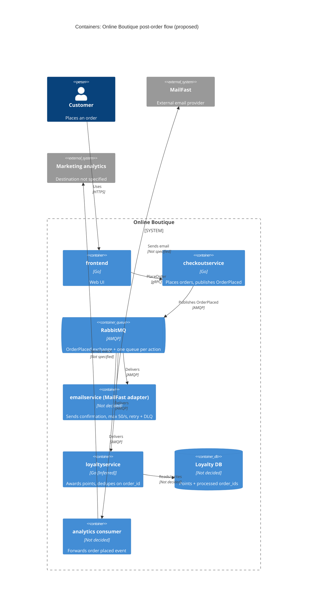

> Agent: Claude Code · Model: Claude Opus 5.5 (`claude-opus-5-5`)

# ADR-0002: Publish an "OrderPlaced" event to RabbitMQ for post-order actions

- **Status:** Proposed
- **Date:** 2026-10-25
- **Deciders:** ทีมพัฒนา Online Boutique (4 developers) — รายชื่อผู้ตัดสินใจจริงยังไม่ระบุ (ดู Open questions)

## Context and problem

Requirement R-12 (`docs/scenario.md`) กำหนดว่าหลังสั่งซื้อสำเร็จ ระบบต้อง (1) ส่งอีเมลยืนยันผ่าน **MailFast** แทน logic mock ของ `emailservice` (2) ให้ loyalty points ผ่าน `loyaltyservice` ตัวใหม่ (3) บันทึก analytics event "order placed" และ marketing คาดว่าจะมี post-order action เพิ่มอีกในปีหน้า (SMS, fraud scoring, recommendations update)

**สภาพปัจจุบัน (จากโค้ด):**

| ข้อเท็จจริง | หลักฐาน |
|---|---|
| `PlaceOrder` เรียก `paymentservice` แล้ว `shippingservice` แบบ synchronous gRPC ตามลำดับ | `system/online-boutique/src/checkoutservice/main.go` (`PlaceOrder`, บรรทัด 252 `chargeCard`, 258 `shipOrder`) |
| อีเมลยืนยันถูกส่งแบบ synchronous gRPC ไป `emailservice` หลังจากตัดเงินและส่งของแล้ว | `main.go` บรรทัด 273 และ `sendOrderConfirmation` (บรรทัด 379–384) |
| ถ้าส่งอีเมลล้มเหลว checkout แค่ log warning และ order ยังสำเร็จ | `main.go` บรรทัด 273–277 (`log.Warnf("failed to send order confirmation ...")`) |
| `checkoutservice` ผูกกับ downstream ทุกตัวผ่าน env var + gRPC connection ที่ตั้งตอน start | `main.go` `mustMapEnv(... "EMAIL_SERVICE_ADDR")` บรรทัด 115, `mustConnGRPC` บรรทัด 118–123 |
| `orderID` สร้างด้วย `uuid.NewUUID()` ต้น `PlaceOrder` | `main.go` บรรทัด 233 |
| `checkoutservice` ไม่มี database ของตัวเอง | ไม่พบการเชื่อมต่อ data store ใน `main.go` (มีแต่ gRPC clients) |

**ตัวเลขที่บังคับการตัดสินใจ** (`docs/scenario.md`):

| หัวข้อ | ค่า | ผลกระทบ |
|---|---|---|
| Checkout latency | p95 `PlaceOrder` ≤ **500 ms** (ปัจจุบัน ~300 ms) | เหลืองบ latency แค่ ~200 ms |
| MailFast latency | p95 **1.5 s**, p99 **8 s** | เรียก MailFast แบบ synchronous ใน `PlaceOrder` จะทำให้ p95 เกิน 500 ms ทันที |
| Peak load vs. MailFast rate limit | **200 orders/s** vs. **50 emails/s** | ช่วง 11.11 อีเมลค้างเพิ่มขึ้น ~150 ฉบับ/วินาที (≈ 9,000 ฉบับต่อนาทีของ peak) ต้องมี buffer และ throttle |
| MailFast failure rate | ~**0.5 %** | ต้องมี retry |
| Loyalty points | ภายใน **1 นาที**, **exactly once** | ต้องไม่ติดคิวเดียวกับอีเมลที่ค้าง และต้อง dedupe |
| Availability | order **ต้องไม่ล้มเหลว** เพราะ email/loyalty/analytics ล่ม | post-order actions ต้องแยกออกจาก critical path |
| Team / Ops | 4 devs, เก่ง Go + gRPC, 2 คนเคยใช้ **RabbitMQ**; รันบน Kubernetes; ชอบ open-source self-hosted | |

**ปัญหา:** จะเชื่อม `checkoutservice` กับ post-order actions อย่างไร ให้ checkout เร็วและไม่ล้มตาม ขณะที่ action ปลายทางทำงานครบ (อีเมลภายใต้ rate limit, loyalty ภายใน 1 นาทีแบบ exactly once) และเพิ่ม action ใหม่ได้โดยไม่แก้ `checkoutservice` ทุกครั้ง

## Decision drivers

1. **Availability:** order ต้องไม่ล้มเพราะ MailFast, `loyaltyservice` หรือ analytics ล่ม
2. **Performance:** p95 `PlaceOrder` ≤ 500 ms ที่ 200 orders/s
3. **Reliability / correctness:** loyalty points ภายใน 1 นาที, exactly once; อีเมลต้องถูก retry เมื่อ MailFast fail (0.5 %) และต้องไม่เกิน 50 emails/s
4. **Modifiability:** เพิ่ม post-order action ใหม่ (SMS, fraud scoring, recommendations) โดยไม่ต้องแก้และ deploy `checkoutservice`
5. **Cost / operability:** open-source, self-hosted บน Kubernetes; ทีมเล็ก 4 คนต้องดูแลได้ (ใช้ทักษะ Go/gRPC/RabbitMQ ที่มีอยู่)

## Considered options

1. **Synchronous gRPC fan-out ใน `PlaceOrder`** — ขยายรูปแบบเดิม: เรียก MailFast adapter, `loyaltyservice`, analytics ทีละตัวแบบ synchronous
2. **Asynchronous in-process (goroutine) ใน `checkoutservice`** — ตอบ client ก่อน แล้วยิง post-order calls ใน background goroutine
3. **Publish event `OrderPlaced` ไป RabbitMQ (self-hosted)** — `checkoutservice` publish หนึ่ง event ไปยัง fanout/topic exchange; แต่ละ action มี queue และ consumer ของตัวเอง
4. **Publish event ไป Apache Kafka (self-hosted)** — แนวคิดเดียวกับข้อ 3 แต่ใช้ log-based broker

### Pros and cons of the options

| Option | Pros | Cons |
|---|---|---|
| 1. Sync gRPC fan-out | ง่าย, ทีมถนัด gRPC; เหมือนโค้ดเดิม; ไม่มี component ใหม่ | MailFast p95 1.5 s ทำให้ p95 checkout เกิน 500 ms; rate limit 50/s รับ 200 orders/s ไม่ได้; ถ้าทำ fail-soft แบบอีเมลเดิม (บรรทัด 273–277) งานที่ fail จะ**หายไป** (ไม่มี retry → loyalty ผิด requirement); `checkoutservice` ต้องแก้ทุกครั้งที่มี action ใหม่ |
| 2. Goroutine ใน `checkoutservice` | latency checkout ไม่เพิ่ม; ไม่มี infrastructure ใหม่ | งานอยู่ในหน่วยความจำ — pod restart/scale-down = งานหาย; คุม rate 50/s ข้าม replicas ไม่ได้; retry/backlog 9,000+ อีเมลต้องทำเองในหน่วยความจำ; ยังคง coupling กับทุก action |
| 3. RabbitMQ events | decouple: checkout แค่ publish (async, durable); queue แยกต่อ action → อีเมลค้างไม่กระทบ loyalty; consumer อีเมล throttle ที่ 50/s และ retry/DLQ ได้; เพิ่ม action ใหม่ = เพิ่ม queue + consumer โดยไม่แตะ checkout; open-source, รันบน Kubernetes; 2 devs มีประสบการณ์ | component stateful ใหม่ต้องดูแล (cluster, quorum queues, monitoring); delivery เป็น at-least-once → consumer ต้อง idempotent; ถ้า publish ล้มหลังตัดเงินแล้ว event อาจหาย (ไม่มี outbox เพราะ checkout ไม่มี DB); eventual consistency |
| 4. Kafka events | throughput สูง, replay event ได้ (มีประโยชน์ต่อ analytics/recommendations); open-source self-hosted | ทีมไม่มีประสบการณ์ Kafka; ดูแลยากกว่าสำหรับทีม 4 คน; 200 events/s ไม่ต้องการ throughput ระดับ Kafka; rate limiting/retry/DLQ ต่อ message ต้องสร้างเองมากกว่า RabbitMQ |

## Decision

เลือก **Option 3: publish event `OrderPlaced` ไปยัง RabbitMQ (self-hosted บน Kubernetes)**

- `checkoutservice.PlaceOrder` publish **หนึ่ง** event `OrderPlaced` (มี `order_id`, email, items, total) หลัง `shipOrder` สำเร็จ แทนการเรียก `emailservice` ที่บรรทัด 273 โดยใช้ publisher confirms และ timeout สั้น; ถ้า publish ล้มเหลว ให้ log + metric แต่ order **ยังสำเร็จ** (คง behaviour fail-soft เดิม)
- Exchange แบบ fanout/topic ผูกกับ **durable queue แยกต่อ action**:
  - `email` → consumer (ปรับ `emailservice` เดิมให้เป็น MailFast adapter) จำกัดอัตรารวมไม่เกิน 50 emails/s, retry แบบ backoff, ส่งไป dead-letter queue เมื่อ retry หมด
  - `loyalty` → `loyaltyservice` บันทึก `order_id` ที่ประมวลผลแล้ว (idempotency key) เพื่อให้ at-least-once delivery กลายเป็น **effectively exactly-once**
  - `analytics` → consumer ที่ส่ง event ให้ระบบ analytics ของ marketing
- Action ในอนาคต (SMS, fraud scoring, recommendations) = เพิ่ม queue + consumer ใหม่ ไม่ต้องแก้ `checkoutservice`

**เหตุผล:** เป็น option เดียวที่ตอบ driver 1–4 พร้อมกัน — ตัด MailFast (p95 1.5 s) ออกจาก critical path, ดูดซับส่วนต่าง 200 vs 50/s ด้วย queue, แยก loyalty ไม่ให้ติดหลังอีเมลที่ค้าง และเปิดทางให้ action ใหม่ ส่วน RabbitMQ ชนะ Kafka ที่ driver 5 (ประสบการณ์ทีม, ความเรียบง่าย, per-message retry/DLQ มีในตัว)

## Consequences

- **Positive:** `PlaceOrder` ไม่ต้องรอ MailFast/loyalty/analytics อีกต่อไป — เพิ่มแค่เวลา publish หนึ่งครั้ง จึงคาดว่า p95 ยังอยู่ใต้ 500 ms (quality attribute: performance) — เวลา publish จริงยังไม่ได้วัด ดู Validation
- **Positive:** order สำเร็จได้แม้ consumer ทุกตัวล่ม; message รออยู่ใน durable queue จน consumer กลับมา (quality attribute: availability)
- **Positive:** queue ดูดซับ peak 200 orders/s แล้วระบายอีเมลที่ 50/s; retry + DLQ รับมือ 0.5 % failure ของ MailFast (quality attribute: reliability, scalability)
- **Positive:** เพิ่ม post-order action ใหม่ได้โดยไม่แก้ `checkoutservice` (quality attribute: modifiability)
- **Negative:** อีเมลยืนยันไม่ได้ส่งทันที — ช่วง 11.11 อาจช้าหลายนาที (backlog ~150 ฉบับ/วินาทีของ peak) (quality attribute: usability / timeliness)
- **Negative:** RabbitMQ เป็น stateful component ใหม่ที่ทีม 4 คนต้องดูแล, monitor และ upgrade (quality attribute: cost, operability)
- **Negative:** debug ยากขึ้น — flow ไม่ใช่ call chain เดียว ต้อง propagate trace context ผ่าน message headers (ปัจจุบันมี OpenTelemetry สำหรับ gRPC ที่ `main.go` บรรทัด 134–140) (quality attribute: observability)
- **Risks and mitigations:**
  - *Event หายถ้า publish ล้มหลังตัดเงินแล้ว* (ไม่มี outbox เพราะ `checkoutservice` ไม่มี DB) → loyalty ไม่ถูกให้ ซึ่งผิด requirement. Mitigation: publisher confirms + retry สั้นๆ ภายในงบ latency, alert บน metric publish-failure; พิจารณา transactional outbox หากมี order store ในอนาคต (ดู Open questions)
  - *Duplicate delivery → double points.* Mitigation: `loyaltyservice` dedupe ด้วย `order_id` (unique constraint) ใน transaction เดียวกับการเพิ่มแต้ม
  - *Loyalty เกิน 1 นาที.* Mitigation: queue แยกจากอีเมล, alert เมื่อ queue age ของ `loyalty` > 30 s
  - *RabbitMQ เป็น single point of failure ของ post-order actions.* Mitigation: รันเป็น cluster 3 nodes พร้อม quorum queues บน Kubernetes
  - *ใช้ quota MailFast เกิน 50/s เมื่อ scale consumer.* Mitigation: กำหนด global rate (เช่น จำนวน consumer × prefetch × rate ต่อ consumer ≤ 50/s) และ test

## Validation

- **Load test** ด้วย 200 orders/s (เช่น Locust `loadgenerator`) ระยะเวลาเท่ากับ peak ของ 11.11 (ยังไม่ทราบ — ดู Open questions) แล้วตรวจ:
  - p95 `PlaceOrder` ≤ 500 ms
  - p99 เวลาจาก order → loyalty points ถูกบันทึก ≤ 60 s
  - อัตราการเรียก MailFast ไม่เกิน 50/s และไม่มี error 429/rate-limit
  - จำนวน loyalty award = จำนวน order พอดี (ไม่มีซ้ำ, ไม่หาย) แม้ inject duplicate message
- **Chaos test:** ปิด RabbitMQ consumer แต่ละตัว และ mock MailFast ให้ fail → order ต้องยังสำเร็จ 100 % และ message ถูกประมวลผลครบเมื่อกลับมา
- **Metrics ใน production:** queue depth/age ต่อ queue, DLQ size, publish-failure count
- **Review date:** ทบทวน ADR หลัง 11.11 ครั้งแรก หรือก่อนเพิ่ม action ใหม่ (SMS/fraud scoring) — วันที่แน่นอนยังไม่ระบุ

## Open questions

- **Deciders:** ใครเป็นผู้อนุมัติ ADR นี้
- **ระยะเวลา peak 11.11:** 200 orders/s คงอยู่นานเท่าไร → ใช้คำนวณ backlog อีเมลและขนาด storage ของ RabbitMQ
- **SLA ของอีเมลยืนยัน:** อีเมลล่าช้าได้สูงสุดกี่นาทีที่ธุรกิจยอมรับ ช่วง peak
- **Latency ของ publish ไป RabbitMQ (พร้อม publisher confirms):** Not evidenced in the provided files — ต้องวัดจริง
- **Event หายยอมรับได้หรือไม่:** ถ้ายอมรับไม่ได้เลย ต้องเพิ่ม order store + transactional outbox ใน `checkoutservice` (ขยาย scope)
- **ปลายทาง analytics:** marketing ใช้ระบบอะไร, รูปแบบ event, ยอมให้หายได้หรือไม่ — Not evidenced in the provided files
- **MailFast API:** protocol (HTTPS/SMTP), รองรับ idempotency key หรือไม่ (กันส่งอีเมลซ้ำเมื่อ retry), rate limit 50/s เป็นต่อ account หรือต่อ connection
- **Data store ของ `loyaltyservice`:** ยังไม่กำหนด; ภาษาที่ใช้ — Go เป็น **[Inferred]** จากทักษะทีม
- **ความพร้อมของทีมในการดูแล RabbitMQ cluster** (on-call, backup, upgrade) — มีแค่ 2 คนที่เคยใช้
- **Fraud scoring ในอนาคต:** อาจต้อง *บล็อก* order (synchronous) ไม่ใช่ post-order action — ถ้าเป็นเช่นนั้นต้องมี ADR แยก
